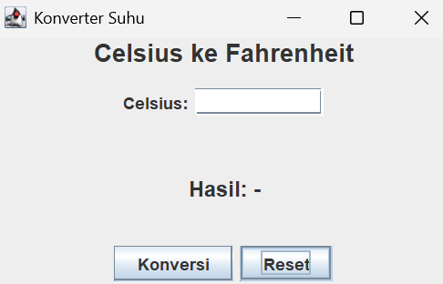
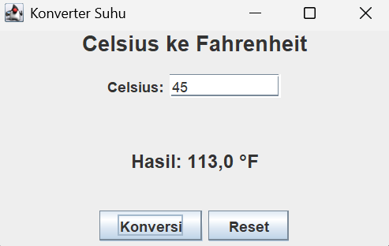

# GUI

# Konverter Suhu

## Nama: Baiq Febylia Eka Ningrum
## NIM: F1D02410109

---

## 1. Deskripsi Aplikasi

Konverter Suhu adalah aplikasi GUI sederhana berbasis Java Swing untuk mengubah suhu dari Celsius ke Fahrenheit.

Rumus: `F = C × 9/5 + 32`

## 2. Fitur

- Input suhu dalam Celsius.
- Konversi dengan tombol **Konversi** atau tekan **Enter**.
- Tombol **Reset** untuk mengosongkan input dan hasil.
- Pesan error jika input bukan angka.

## 3. Komponen GUI

### Top Level Container
- `JFrame`: jendela utama (`SuhuApp extends JFrame`).

### Intermediate Component
- `JPanel`: `panelInput`, `panelTengah`, dan `panelTombol` untuk mengelompokkan komponen.

### Atomic Component
- `JLabel`: judul, label "Celsius:", dan hasil konversi.
- `JTextField`: input suhu Celsius.
- `JButton`: tombol Konversi dan Reset.

## 4. Layout Manager

- `BorderLayout`: mengatur JFrame (judul di NORTH, panel tengah di CENTER, tombol di SOUTH).
- `FlowLayout`: menyusun label + textfield dan dua tombol secara berurutan.
- `GridLayout`: membagi panel tengah menjadi 2 baris (input dan hasil).

## 5. Event Handling

Class `SuhuApp` mengimplementasikan dua interface:

- `ActionListener`: `actionPerformed()` menangani klik tombol Konversi dan Reset. `e.getSource()` dipakai untuk mengetahui tombol yang diklik.
- `KeyListener`: `keyPressed()` mendeteksi tombol Enter pada textfield untuk menjalankan konversi. Method `keyReleased()` dan `keyTyped()` dibiarkan kosong karena wajib ada saat implements `KeyListener`.

## 6. Cara Menjalankan

```bash
javac SuhuApp.java
java SuhuApp
```

## 7. Screenshot


