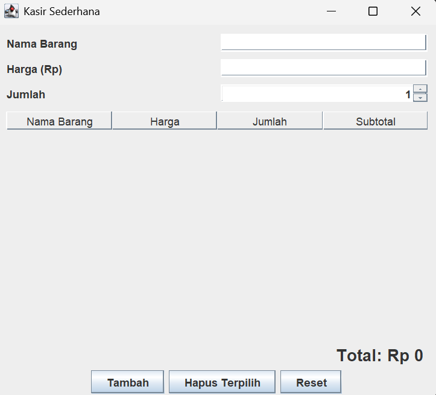
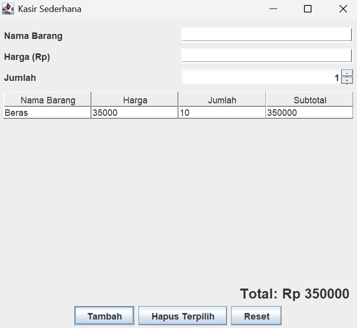

# GUI


# Kasir Sederhana

## Nama: Baiq Febylia Eka Ningrum
## NIM: F1D02410109

---

## 1. Deskripsi Aplikasi

Kasir Sederhana adalah aplikasi GUI berbasis Java Swing untuk mencatat barang belanja dan menghitung total harganya. Pengguna mengisi nama barang, harga, dan jumlah, lalu barang ditampilkan di tabel beserta subtotalnya.

Rumus:
- `Subtotal = harga × jumlah`
- `Total = jumlah dari semua subtotal`

## 2. Fitur

- Menambah barang (tombol **Tambah** atau tekan **Enter** di kolom harga).
- Menampilkan daftar barang dalam tabel.
- Menghitung total belanja otomatis.
- Menghapus barang yang dipilih di tabel.
- Mereset seluruh daftar.
- Validasi input (nama kosong, harga bukan angka).

## 3. Struktur Proyek

```
TUGAS-GUI/
├── Barang.java
├── KasirApp.java
├── README.md
├── .gitignore
└── screenshot/
```

- `Barang.java`: class model (nama, harga, jumlah, subtotal).
- `KasirApp.java`: tampilan GUI, event handling, dan method `main`.

## 4. Komponen GUI

### Top Level Container
- `JFrame`: jendela utama (`KasirApp extends JFrame`).
- `JOptionPane`: dialog peringatan dan error.

### Intermediate Component
- `JPanel`: `panelForm`, `panelTombol`, `panelBawah`.
- `JScrollPane`: membungkus `JTable` agar bisa di-scroll.

### Atomic Component
- `JLabel`: label form dan total belanja.
- `JTextField`: input nama dan harga.
- `JSpinner`: input jumlah (1-100).
- `JButton`: Tambah, Hapus Terpilih, Reset.
- `JTable`: menampilkan daftar barang (datanya dikelola `DefaultTableModel`).

## 5. Layout Manager

- `BorderLayout`: kerangka JFrame (form di NORTH, tabel di CENTER, total + tombol di SOUTH).
- `GridLayout`: form input 3 baris × 2 kolom (label dan field sejajar rapi).
- `FlowLayout`: tiga tombol berjajar dalam satu baris.

## 6. Event Handling

Class `KasirApp` mengimplementasikan dua interface:

- `ActionListener`: `actionPerformed()` menangani klik tombol Tambah, Hapus Terpilih, dan Reset. `e.getSource()` dipakai untuk mengetahui tombol mana yang diklik.
- `KeyListener`: `keyPressed()` mendeteksi tombol Enter pada kolom harga untuk menambah barang. `keyReleased()` dan `keyTyped()` dibiarkan kosong karena wajib ada saat implements `KeyListener`.

## 7. Cara Menjalankan

```bash
javac *.java
java KasirApp
```

## 8. Penyimpanan Data

Data barang disimpan sementara di memori (`ArrayList<Barang>`) selama aplikasi berjalan. Data tidak disimpan ke file atau database, sehingga akan hilang ketika aplikasi ditutup.

## 9. Screenshot


